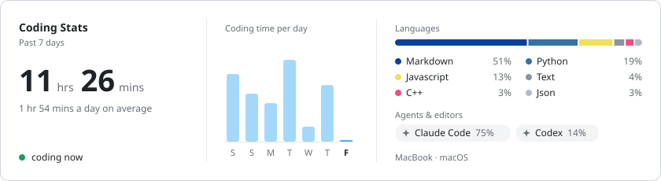

<h1 align="center">Xiang Li</h1>

  <b>AI Systems · LLM Agents · Distributed Systems</b> 
  MS in Information Networking @ Carnegie Mellon University · BEng @ Huazhong University of Science and Technology

  
  
  

I build scalable backend systems and production-oriented LLM pipelines, with a growing focus on AI infrastructure and agent systems.

## What I'm coding this week

  <a href="https://xloverflow.github.io">
    <picture>
      <source media="(prefers-color-scheme: dark)" srcset="assets/coding-stats-dark.svg"/>
      
    </picture>
  </a>

Self-hosted and refreshed every few hours: editor plugins report to my own <a href="https://github.com/muety/wakapi">Wakapi</a> on a Mac mini, a small API renders the card.

## Current interests

<table>
  <tr><td><b>LLM agents</b></td><td>Tool calling · RAG systems · multi-step reasoning</td></tr>
  <tr><td><b>AI infrastructure</b></td><td>LLM systems · ML systems</td></tr>
  <tr><td><b>Distributed systems</b></td><td>Raft · consistency · fault tolerance</td></tr>
  <tr><td><b>System foundations</b></td><td>Database internals · storage engines</td></tr>
</table>

## Selected projects

- **[TinyKV](https://github.com/XLOverflow/tinykv)** — distributed key-value store on Raft (100K+ ops/sec)
- **[super-biz-agent](https://github.com/XLOverflow/super-biz-agent)** — Go-based LLM agent with hybrid RAG retrieval and ReAct tool calling
- **BusTub** — C++ DBMS internals (CMU 15-445)

## Latest from the blog

<!-- BLOG-POSTS:START -->
- [11711 Advanced NLP: Parallelism and Scaling](https://xloverflow.github.io/2026/04/07/11711-Advanced-NLP/11711-Advanced-NLP-Parallelism-Scaling/) 2026-04-07
- [11711 Advanced NLP: Quantization](https://xloverflow.github.io/2026/04/07/11711-Advanced-NLP/11711-Advanced-NLP-Quantization/) 2026-04-07
- [11868 LLM Sys: Systems for Mixture-of-Experts Models](https://xloverflow.github.io/2026/03/21/11868-LLM-Sys/11868-LLM-Sys-MoE-Systems/) 2026-03-21
- [15645 Database systems: Query Optimization](https://xloverflow.github.io/2026/03/20/15645-Database-Systems/15645-Database-systems-Query-Optimization/) 2026-03-20
- [15645 Database systems: Query Execution](https://xloverflow.github.io/2026/03/15/15645-Database-Systems/15645-Database-systems-Query-Execution/) 2026-03-15
<!-- BLOG-POSTS:END -->

More at <a href="https://xloverflow.github.io">xloverflow.github.io</a> · 中文版在 <a href="https://xloverflow.github.io/zh/">/zh/</a>
